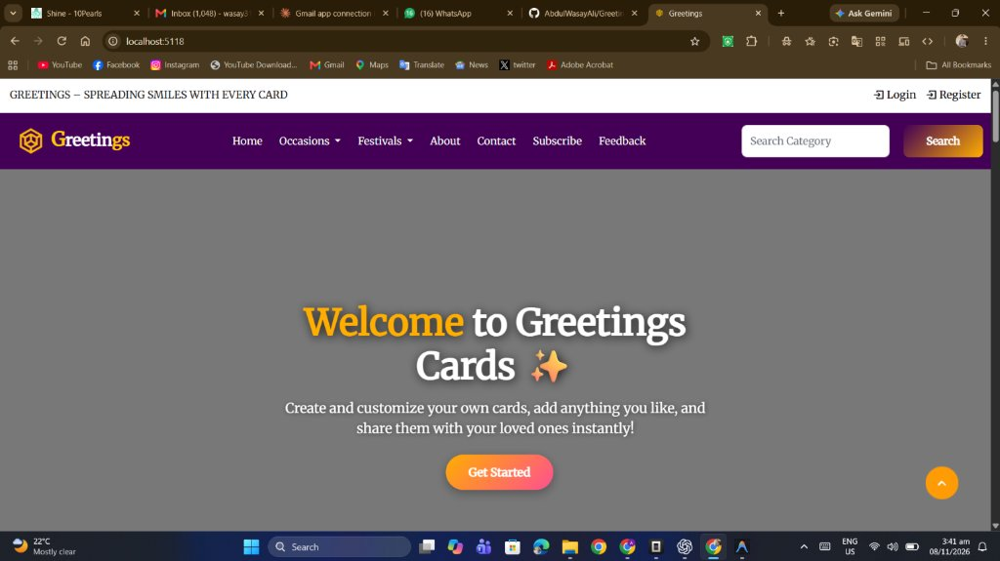

# Greeting Cards - Spreading Smiles With Every Card ✨

An interactive, responsive, and full-stack ASP.NET Core 8.0 MVC web application designed for exploring, personalizing, and sending dynamic digital greeting cards across diverse occasions and festivals.

<p align="center">
  <a href="http://greetings.runasp.net" target="_blank">
    
  </a>
  <a href="https://github.com/AbdulWasayAli/Greetings-Project/actions" target="_blank">
    
  </a>
  
  
</p>

<p align="center">
  <a href="http://greetings.runasp.net" target="_blank">
    
  </a>
</p>

<p align="center">
  <b>🌐 Live Demo: <a href="http://greetings.runasp.net" target="_blank">http://greetings.runasp.net</a></b>
</p>

---

## 🌐 Live Demo

- **Live URL**: [http://greetings.runasp.net](http://greetings.runasp.net)
- **Deployment Status**: Automated CI/CD pipeline enabled via **GitHub Actions** (`main` branch triggers auto-build & deploy).

---

## 📌 Project Overview

**Greeting Cards** is a digital greeting cards platform that enables users to browse culturally diverse occasions, personalize greetings with bespoke text and recipient information, and preview cards through realistic front-and-back flip interactions. 

The application incorporates background video playback, user subscription tiers for card sending allowances, visitor feedback and star ratings, and an administrative control center for content moderation and operational insights.

---

## 🛠️ Technology Stack & Explicit Versions

| Layer | Component | Version | Description |
| :--- | :--- | :--- | :--- |
| **Backend Engine** | .NET (ASP.NET Core MVC) | `8.0` (`net8.0`) | Cross-platform web framework |
| **Data Access / ORM** | Entity Framework Core | `8.0.19` | Database abstraction & LINQ query provider |
| **Database Provider** | SQLite | `8.0.19` | Zero-configuration local database (`app.db`) |
| **Tooling & Design** | EF Core Design & Tools | `8.0.19` | Code-first database migrations & CLI support |
| **Frontend Templates** | Razor Views (`.cshtml`) | ASP.NET Core 8 | Server-rendered dynamic HTML templates |
| **Styling & Grid** | Bootstrap | `5.3` | Mobile-first responsive UI framework |
| **Icons** | FontAwesome | `6.0` | Comprehensive icon library |
| **Scroll Animations** | AOS (Animate on Scroll) | `2.3.1` | Scroll-triggered component animations |
| **Containerization** | Docker | Multi-stage | Build: `sdk:8.0`, Runtime: `aspnet:8.0` |

---

## 🎯 What the Project Does & How It Works

### 1. 🎴 Dynamic Card Browsing & Selection
- Users land on a hero section enhanced with high-definition looping video backgrounds.
- Users can choose from **8 distinct categories**:
  - 🎂 **Birthday**
  - 💒 **Wedding**
  - 🎊 **New Year**
  - 🌙 **Eid-ul-Fitr**
  - 🕌 **Eid-ul-Adha**
  - 🎄 **Christmas**
  - 🦃 **Thanksgiving**
  - 🪔 **Diwali**
- Each category features **12 unique cards** with custom visual artwork, sample messages, and interactive 3D CSS front-and-back flip effects upon hover or click.

### 2. ✏️ In-Browser Card Personalization & Dispatch
- Clicking **"Customize"** opens a dedicated customization modal.
- Users can modify card titles, write personalized heartfelt messages, input the recipient's name and email address, and view real-time card previews.
- When sent, the application creates a persistent record in the `CardSends` table to track delivery status, timestamps, and message history.

### 3. ⭐ User Feedback & Rating System
- Visitors and registered users can submit comments along with an interactive **1 to 5 star rating**.
- Submitted feedback is stored in the database and displayed across community review sections.

### 4. 💳 Tiered Subscription System
- Supports access tiers (such as Free and Pro plans) that define card sending allowances.
- Protects features via authorization filters and session-based state management.

### 5. 🛡️ Administrative Suite
- A dedicated administrative area (`/Admin`) equipped with:
  - **Dashboard:** Platform metrics (total users, active categories, cards, feedbacks, and sending statistics).
  - **Catalog Management:** Create, edit, and delete categories and individual card artwork.
  - **Analytics:** Visual activity breakdowns and user engagement data.
  - **Report Generation:** Export system summaries to CSV formats.
  - **Feedback Moderation:** Monitor, filter, and review incoming user feedback.

---

## 📂 Project Structure

```text
Greetings-Project/
├── Dockerfile                        # Multi-stage production container build
├── E-Project.sln                     # Visual Studio Solution File
├── README.md                         # Project documentation
│
└── E-Project/                        # Main Application Root
    ├── appsettings.json              # Connection strings & logging levels
    ├── E-Project.csproj              # NuGet package references & target framework
    ├── Program.cs                    # Application startup, DI services & middleware pipeline
    │
    ├── Controllers/
    │   ├── HomeController.cs         # Public workflows: card browsing, sending & feedback
    │   └── AdminController.cs        # Admin operations: dashboard, analytics & reports
    │
    ├── Data/
    │   ├── ApplicationDbContext.cs   # Entity Framework context & table mapping
    │   └── SeedData.cs               # Automatic catalog population logic
    │
    ├── Filters/
    │   └── PreventAdminAccessToMainSiteFilter.cs   # Route protection filters
    │
    ├── Middleware/
    │   └── AdminNavigationLockMiddleware.cs        # Administrative session navigation control
    │
    ├── Models/                       # Entities: Card, Category, User, CardSend, Feedback, etc.
    ├── Views/                        # Razor view hierarchy (Home, Admin, and Shared layouts)
    └── wwwroot/                      # Client assets (CSS, JS, card media & video backdrops)
```

---

## 💻 Running Locally

### Prerequisites
- [.NET 8.0 SDK](https://dotnet.microsoft.com/download/dotnet/8.0) installed on your system.
- No external SQL Server installation is required (SQLite runs out of the box).

### Quick Start

1. **Clone the repository:**
   ```bash
   git clone https://github.com/AbdulWasayAli/Greetings-Project.git
   cd Greetings-Project/E-Project
   ```

2. **Restore dependencies & run:**
   ```bash
   dotnet restore
   dotnet run
   ```

3. **Access the application:**
   Open your browser and navigate to:
   ```text
   http://localhost:5118
   ```

*(On the first launch, the local database `app.db` will automatically initialize and populate all 8 categories and 96 cards.)*

---

## ☁️ Deployment

The included production `Dockerfile` supports instant deployment to containerized hosts including **Render**, **Railway**, and **Azure App Service**.
