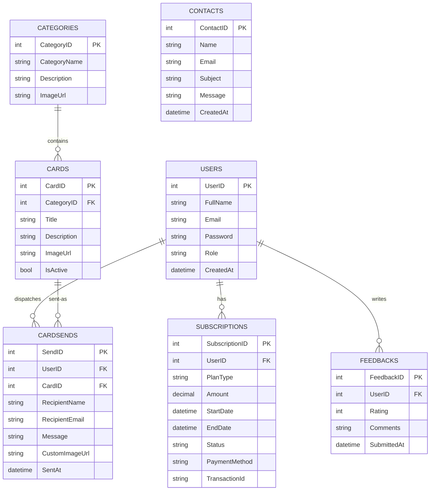

# 💌 Greetings Cards Web Application (E-Project)

[](https://dotnet.microsoft.com/)
[](https://docs.microsoft.com/ef/core/)
[](https://www.microsoft.com/sql-server/)
[](https://dotnet.microsoft.com/apps/aspnet/mvc)
[](https://dotnet.microsoft.com/)

An enterprise-ready, full-featured **ASP.NET Core 8.0 MVC** web application designed for browsing, customizing, previewing, and sending personalized greeting cards via automated email workflows. Features user authentication, tier-based Pro subscriptions, full administrative content control, interactive analytics, and scheduled reporting.

---

## 📑 Table of Contents
- [Project Overview](#-project-overview)
- [Key Features](#-key-features)
  - [User Experience & Card Delivery](#1-user-experience--card-delivery)
  - [Pro Subscription Engine](#2-pro-subscription-engine)
  - [Administrative Dashboard & Governance](#3-administrative-dashboard--governance)
  - [Security & Access Control](#4-security--access-control)
- [Technical Architecture & Versions](#-technical-architecture--versions)
- [Folder & Solution Structure](#-folder--solution-structure)
- [Database Models & Relationships](#-database-models--relationships)
- [Prerequisites & System Requirements](#-prerequisites--system-requirements)
- [Installation & Getting Started](#-installation--getting-started)
- [Configuration Reference](#-configuration-reference)
- [Database Migrations & Backup](#-database-migrations--backup)
- [Email Engine (SMTP Integration)](#-email-engine-smtp-integration)
- [Default Seed Data](#-default-seed-data)
- [Contributing & License](#-contributing--license)

---

## 🌟 Project Overview

**Greetings Cards Web App** is an end-to-end digital greeting card platform built on the modern Microsoft .NET 8 ecosystem. It connects users celebrating festive occasions (such as Eid, Birthdays, Weddings, New Year, Diwali, Christmas, etc.) with customizable high-resolution templates and an integrated email delivery pipeline.

Users can browse cards by category, subscribe to a Pro membership plan, customize recipient details with custom messages and imagery, and schedule or send greeting cards straight to recipients' inboxes. Simultaneously, administrators get a rich back-office interface for tracking platform growth, reviewing feedback, updating content catalogs, and exporting reports.

---

## ✨ Key Features

### 1. User Experience & Card Delivery
* **Dynamic Category Catalog:** Filter and search cards across festive, milestone, and celebration categories with responsive image galleries.
* **Modern Media Support:** Native static asset pipeline configured with MIME handling for high-efficiency modern image formats including **AVIF**, **WebP**, PNG, and JPEG.
* **Personalized Card Customizer:** 
  * Add custom greeting text, sender name, and recipient emails.
  * Upload custom user images or choose pre-designed card templates.
  * Automatic base64 image decoding and persistent storage in `wwwroot/uploads/`.
* **Rich HTML Email Dispatcher:** 
  * Beautiful inline CSS email templates (`GenerateStyledEmailHtml()`).
  * Direct SMTP integration with Gmail/custom SMTP gateways.
  * Embedded visual assets for high email client compatibility.
* **Daily Quota Management:** Built-in safeguards enforcing daily sending limits (10 cards/day for Pro tier members) to prevent abuse and SMTP rate-limiting.
* **Customer Feedback & Inquiries:** Integrated feedback rating system and Contact Us communication forms.

### 2. Pro Subscription Engine
* **Tiered Subscription Model:** Gate card delivery behind an active Pro subscription.
* **Transaction Tracking:** Tracks `PlanType`, `Amount`, `StartDate`, `EndDate`, `Status`, `PaymentMethod`, and `TransactionId`.
* **Subscription Management:** Users can view subscription statuses; administrators can audit active subscribers and revoke or cancel plans.

### 3. Administrative Dashboard & Governance
* **Executive Metric Cards:** Real-time visibility into Total Users, Active Subscriptions, Total Revenue, Cards Dispatched, and Feedback Ratings.
* **CRUD Content Management:**
  * **Categories:** Add, edit, or delete card categories with custom cover image upload.
  * **Cards:** Full catalog management (titles, descriptions, category links, image uploads).
  * **Users:** Manage user roles (`Admin` / `User`), edit profile data, and inspect user activity histories.
* **Interactive Analytics:** Data visual summaries of popular categories, seasonal engagement, and financial growth.
* **Multi-Format Export Reports:**
  * **Excel / CSV Exports:** Quick data downloads for offline accounting and audits.
  * **PDF-Ready Print Reports:** Rendered HTML printable reporting views.
* **Moderation Panels:** Dedicated interfaces for resolving Contact inquiries and reviewing user feedback submissions.

### 4. Security & Access Control
* **Session Authentication:** Session state handling via `HttpContext.Session` (`UserName`, `UserRole`) with 30-minute sliding timeout windows.
* **Role-Based Routing Filters:** Action-level permission gates protecting `/Admin/*` routes.
* **Admin Navigation Lock:** Custom middleware (`AdminNavigationLockMiddleware`) and action filters (`PreventAdminAccessToMainSiteFilter`) preventing administrative sessions from inadvertently mixing with public consumer routes.

---

## 🛠 Technical Architecture & Versions

| Component / Layer | Technology | Version | Notes |
| :--- | :--- | :--- | :--- |
| **Runtime Framework** | .NET (Core) | `net8.0` | High-performance C# runtime |
| **Web Architecture** | ASP.NET Core MVC | 8.0 | Model-View-Controller pattern |
| **Object-Relational Mapper (ORM)** | Entity Framework Core | `8.0.19` | Code-First + Migrations |
| **Database Engine** | Microsoft SQL Server | 2019 / 2022+ | Relational data persistence |
| **Database Tooling** | `Microsoft.EntityFrameworkCore.Tools` | `8.0.19` | CLI & PMC migration commands |
| **Design Package** | `Microsoft.EntityFrameworkCore.Design` | `8.0.19` | EF Core design-time services |
| **Session State** | Distributed Memory Cache | .NET 8 built-in | HttpOnly essential session cookie |
| **Frontend UI** | Razor Views (`.cshtml`), HTML5, CSS3, JS | - | Bootstrap & custom styles |
| **Mailing Protocol** | `System.Net.Mail.SmtpClient` | .NET 8 built-in | Automated transactional email dispatch |

---

## 📂 Folder & Solution Structure

```plaintext
E-Project final/
│
├── .github/                           # GitHub workflows and project automation
├── Database/
│   └── project.bak                    # SQL Server complete database backup snapshot
├── E-Project.sln                      # Visual Studio Solution entry point
├── README.md                          # Comprehensive project documentation
│
└── E-Project/                         # Main ASP.NET Core Web Application
    ├── Controllers/
    │   ├── AdminController.cs         # Back-office CRUD, analytics, reporting & user management
    │   └── HomeController.cs          # Public storefront, auth, checkout, card customizer & emailer
    │
    ├── Data/
    │   ├── ApplicationDbContext.cs    # EF Core DB context with DbSets and Fluent API mappings
    │   └── SeedData.cs                # Automatic initial database seeder for categories & cards
    │
    ├── Filters/
    │   └── PreventAdminAccessToMainSiteFilter.cs # Controller filter keeping admins in the portal
    │
    ├── Middleware/
    │   └── AdminNavigationLockMiddleware.cs      # Pipeline middleware enforcing role isolation
    │
    ├── Migrations/                    # EF Core schema migration snapshots and C# history
    │
    ├── Models/
    │   ├── Card.cs                    # Greeting card entity model
    │   ├── CardSend.cs                # Card dispatch log and recipient transaction model
    │   ├── Category.cs                # Greeting category classification model
    │   ├── Contact.cs                 # User contact form message model
    │   ├── ErrorViewModel.cs          # Standard error display model
    │   ├── Feedback.cs                # User reviews, star ratings, and testimonials
    │   ├── SendCardModel.cs           # Form binding model for card transmission
    │   ├── Subscription.cs            # Pro tier subscription and billing model
    │   └── User.cs                    # Application user and admin account entity
    │
    ├── Views/
    │   ├── Admin/                     # Back-office Razor views (Analytics, Users, Cards, etc.)
    │   ├── Home/                      # Public consumer views (Cards, Login, Register, SendCard, etc.)
    │   └── Shared/                    # Shared layouts (_Layout.cshtml, navbars, footers)
    │
    ├── wwwroot/                       # Static web server assets
    │   ├── css/                       # Custom style sheets
    │   ├── js/                        # Client-side scripts and interaction logic
    │   ├── images/                    # Template card stock illustrations and iconography
    │   └── uploads/                   # Runtime user and admin uploaded file repository
    │       ├── cards/                 # Custom greeting card image files
    │       └── categories/            # Category hero banners and thumbnails
    │
    ├── appsettings.json               # Primary environment and DB connection configuration
    ├── appsettings.Development.json   # Local development debugging overrides
    ├── E-Project.csproj               # Project dependencies and target framework manifest
    └── Program.cs                     # WebApplication host builder, middleware pipeline, DI container
```

---

## 🗄 Database Models & Relationships

The project utilizes **Entity Framework Core (Code First)** mapped to SQL Server:



---

## 💻 Prerequisites & System Requirements

Before running the project locally, verify you have the following installed:

1. **[.NET 8.0 SDK](https://dotnet.microsoft.com/download/dotnet/8.0)** (v8.0.x or higher)
2. **[Microsoft SQL Server](https://www.microsoft.com/sql-server/sql-server-downloads)** (SQL Server 2019/2022, Developer or Express Edition, or LocalDB)
3. **[SQL Server Management Studio (SSMS)](https://learn.microsoft.com/sql/ssms/download-sql-server-management-studio-ssms)** or **Azure Data Studio**
4. **IDE:** [Visual Studio 2022](https://visualstudio.microsoft.com/) (version 17.8+ with ASP.NET and web development workload) or [Visual Studio Code](https://code.visualstudio.com/) with C# Dev Kit.

---

## 🚀 Installation & Getting Started

### 1. Clone the Repository
```bash
git clone https://github.com/AbdulWasayAli/Greetings-Project.git
cd Greetings-Project
```

### 2. Configure Database Connection
Open `E-Project/appsettings.json` and adjust the connection string to match your local SQL Server instance:

```json
{
  "ConnectionStrings": {
    "DefaultConnection": "Server=YOUR_SERVER_NAME; Database=E-Project; Trusted_Connection=True; TrustServerCertificate=True; MultipleActiveResultSets=true"
  }
}
```

### 3. Restore Packages & Apply Database Migrations
Open terminal in the solution directory and run:

```bash
# Restore NuGet dependencies
dotnet restore

# Apply EF Core migrations to generate database tables
dotnet ef database update --project E-Project
```

*(Alternatively, you can restore the pre-populated database snapshot from `Database/project.bak` via SSMS).*

### 4. Build and Run the Application
```bash
dotnet run --project E-Project
```

Once started, open your web browser and navigate to:
```plaintext
https://localhost:5001   or   http://localhost:5000
```

---

## ⚙️ Configuration Reference

### Session State Configuration (`Program.cs`)
```csharp
builder.Services.AddDistributedMemoryCache();
builder.Services.AddSession(options =>
{
    options.IdleTimeout = TimeSpan.FromMinutes(30);
    options.Cookie.HttpOnly = true;
    options.Cookie.IsEssential = true;
});
```

### Static File & AVIF Provider (`Program.cs`)
```csharp
var provider = new FileExtensionContentTypeProvider();
provider.Mappings[".avif"] = "image/avif";

app.UseStaticFiles(new StaticFileOptions
{
    ContentTypeProvider = provider
});
```

---

## 💾 Database Migrations & Backup

* **Apply Latest Schema:**
  ```bash
  dotnet ef database update --project E-Project
  ```
* **Add a New Migration:**
  ```bash
  dotnet ef migrations add <MigrationName> --project E-Project
  ```
* **Revert Last Migration:**
  ```bash
  dotnet ef migrations remove --project E-Project
  ```
* **Pre-made Database Backup (`.bak`):**
  A production-ready database backup with sample cards and operational accounts is provided inside the [`Database/project.bak`](file:///d:/source/repos/E-Project%20final/Database/project.bak) file. It can be directly restored using SQL Server Management Studio (SSMS).

---

## 📧 Email Engine (SMTP Integration)

Card transmission uses .NET's `System.Net.Mail` configured inside [`HomeController.cs`](file:///d:/source/repos/E-Project%20final/E-Project/Controllers/HomeController.cs):
* **Custom Email Styling:** Generates custom-styled HTML emails containing personalized greetings, messages, and embedded greeting graphics.
* **Upload Attachment Handling:** If a user chooses to upload a custom image or card layout, the base64 string is converted, safely written to disk in `wwwroot/uploads/`, and attached or referenced inline within the outbound email.
* **Production Recommendation:** For production deployments, transition credentials from source files to Environment Variables, `dotnet user-secrets`, or Azure Key Vault.

---

## 🌱 Default Seed Data

When the application boots with an empty database, [`SeedData.cs`](file:///d:/source/repos/E-Project%20final/E-Project/Data/SeedData.cs) automatically populates essential festive categories and sample cards:
* 🎂 **Birthday**
* 💍 **Wedding**
* 🎆 **New Year**
* 🌙 **Eid-ul-Fitr**
* 🐑 **Eid-ul-Adha**
* 🎄 **Christmas**
* 🦃 **Thanksgiving**
* 🪔 **Diwali**

---

## 🤝 Contributing & License

1. Fork the repository
2. Create your feature branch (`git checkout -b feature/AmazingFeature`)
3. Commit your changes (`git commit -m 'Add some AmazingFeature'`)
4. Push to the branch (`git push origin feature/AmazingFeature`)
5. Open a Pull Request

Distributed under the **MIT License**. Feel free to use and adapt this project for educational and commercial purposes.

---

<p align="center">
  Developed by <b>Abdul Wasay Ali</b> • Built with ❤️ using ASP.NET Core & C#
</p>
